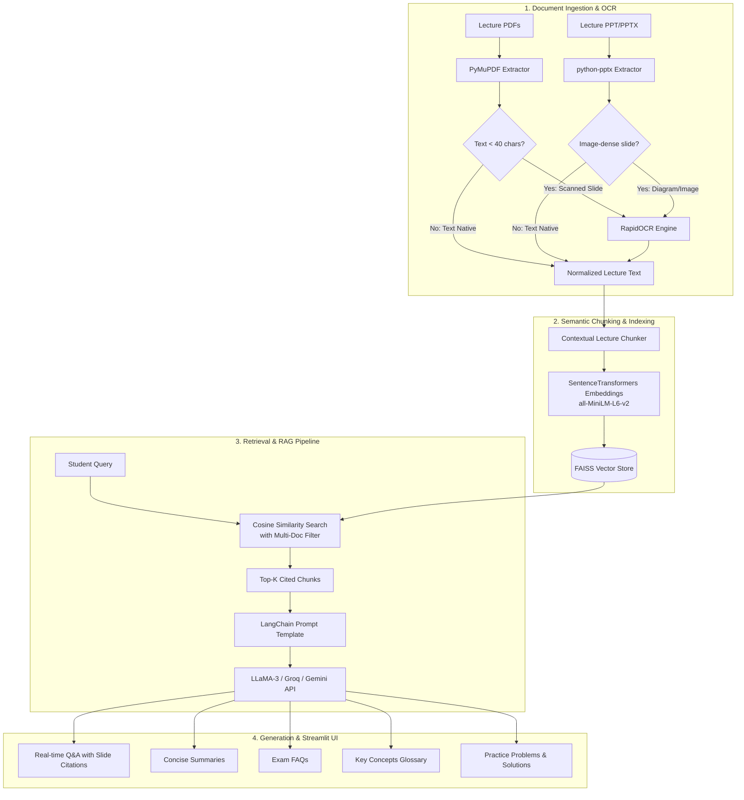

# 📚 LectureLens: Academic Lecture RAG Application

An end-to-end Retrieval-Augmented Generation (RAG) platform that extracts and processes content from academic lecture PDFs and PPT/PPTX slide decks to generate concise summaries, FAQs, key concepts, and exam practice problems.

Powered by **PyMuPDF**, **python-pptx**, **RapidOCR**, **FAISS**, **SentenceTransformers**, **LangChain**, and **LLaMA-3** APIs.

---

## 🌟 Key Features

1. **Multi-Format Document Ingestion**:
   - **PyMuPDF (`pymupdf`)**: High-speed, robust PDF extraction capturing text blocks, headings, and page structures.
   - **`python-pptx`**: Ingestion of presentation slide decks, extracting slide titles, bullet hierarchies, tables, and professor speaker notes.
   - **Multi-Document Management**: Upload and index entire semester-long courses (e.g. Week 1 through Week 14) simultaneously.

2. **Automated OCR-Based Text Extraction**:
   - Built-in **RapidOCR (ONNX)** engine with Tesseract fallback.
   - Automatically detects scanned lecture slides, diagrams, and image-heavy pages with low native text and performs optical character recognition with reading-order preservation.

3. **Semantic Text Chunking**:
   - Context-preserving chunking using `RecursiveCharacterTextSplitter`.
   - Injects slide headers (`[PDF: CS301_Lecture.pdf | Slide/Page 3: Attention Mechanism]`) directly into chunks to ground embeddings and LLM reasoning.

4. **Vector Retrieval Powered by FAISS & SentenceTransformers**:
   - Dense embeddings with `sentence-transformers/all-MiniLM-L6-v2` (cosine similarity with normalized inner product).
   - Multi-document filtering: Query across all semester lectures or target specific lecture files.
   - Exact source attribution: Responses cite specific document filenames and slide/page numbers.

5. **LLM Integration via LangChain**:
   - **LLaMA-3** via **Groq** (`llama-3.3-70b-versatile`, `llama-3.1-8b-instant`, `llama-3.2-3b-preview`) for ultra-fast, free-tier real-time inference.
   - **Google Gemini** (`gemini-2.0-flash`, `gemini-1.5-flash`) via `langchain-google-genai`.
   - **Local Ollama** support for offline setups.
   - Intelligent local fallback for testing without external API keys.

6. **Educational Study Aids Generator**:
   - 📖 **Concise Module Summaries**: High-level thesis, core syllabus breakdown, and high-yield takeaways.
   - ❓ **Frequently Asked Questions (FAQs)**: High-frequency exam questions with pedagogical explanations.
   - 🧠 **Key Concepts & Glossary**: Terminology tables with definitions, formulas, and slide references.
   - ✍️ **Exam Practice Problems**: Multiple-choice questions (MCQs with reasoning) and analytical short-answer problems with step-by-step solutions.
   - 📥 **Export to Markdown**: Download a complete revision pack with a single click.

---

## 🏗️ System Architecture



---

## 🚀 Quick Start Guide

### 1. Prerequisites & Virtual Environment
Ensure you have Python 3.10+ installed.

```bash
# Clone the repository and navigate into the folder
cd lecture-tool

# Activate the virtual environment (Windows PowerShell)
.venv\Scripts\Activate.ps1

# Or install dependencies
pip install -r requirements.txt
```

### 2. Configure API Keys (Optional but Recommended)
Copy `.env.example` to `.env`:
```bash
cp .env.example .env
```
Provide your free **Groq API Key** (`gsk_...`) from [Groq Console](https://console.groq.com) or Google Gemini API key from [Google AI Studio](https://aistudio.google.com). You can also enter the key directly in the Streamlit sidebar.

### 3. Launch the Streamlit Web App
```bash
streamlit run app.py
```
Open your browser at `http://localhost:8501`.

---

## 🧪 Running the Automated Test Suite

A comprehensive test suite verifies PDF parsing, PPTX extraction, OCR, semantic chunking, vector indexing, similarity search, and RAG generation:

```bash
python -m unittest tests/test_pipeline.py -v
```

---

## 📂 Project Structure

```
lecture-tool/
├── app.py                     # Interactive Streamlit Web Application
├── requirements.txt           # Frozen project dependencies
├── .env.example               # Environment variable templates
├── README.md                  # Documentation and architecture guide
├── src/
│   ├── __init__.py
│   ├── config.py              # Configuration constants & RAG settings
│   ├── parser.py              # PyMuPDF and python-pptx extraction logic
│   ├── ocr_engine.py          # RapidOCR (ONNX) engine for scanned slides
│   ├── chunker.py             # Context-preserving semantic text chunker
│   ├── vector_store.py        # FAISS vector store & SentenceTransformers wrapper
│   ├── rag_engine.py          # LangChain RAG pipeline with Groq (LLaMA-3) & Gemini
│   ├── generator.py           # Summaries, FAQs, Key Concepts, and Practice Problems
│   └── utils.py               # Sample generation, metrics, and Markdown export
├── tests/
│   └── test_pipeline.py       # Automated unit tests
└── sample_data/               # Sample lecture PDF and PPTX decks
```

---

## 💡 How to Use

1. **Document Studio**:
   - Drag & drop your `.pdf` and `.pptx` slides.
   - Click **"Process & Index Uploaded Documents"**.
   - Or click **"Load Samples"** in the sidebar to test immediately with built-in Deep Learning lectures.
2. **Lecture Q&A Chat**:
   - Ask any conceptual question (e.g. *"Why is the scaling factor 1/sqrt(d_k) used in attention?"*).
   - View answers with precise citations (`[Lecture 05 - Slide 3]`).
   - Expand the **Source Citations** accordion to view matched slides and similarity scores.
3. **Study Pack Generator**:
   - Click to generate **Summaries**, **FAQs**, **Key Concepts**, or **Practice Problems**.
   - Click **"Download Master Study Guide (.md)"** to save your revision materials.
4. **Semester Search**:
   - Enter keywords to locate exact lecture slides across weeks of course content.
